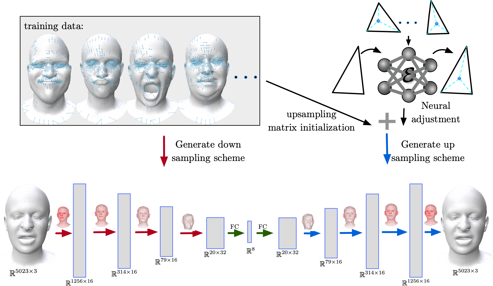

# Neural QSLIM for Mesh Autoencoders

Official implementation of **Neural QSLIM for Mesh Autoencoders**, published in *Artificial Neural Networks and Machine Learning – ICANN 2025* (Springer, 2026).

Neural QSLIM introduces a geometry-aware mesh upsampling method for mesh autoencoders. Unlike conventional approaches that construct fixed sampling matrices from a single template mesh, our method uses QSLIM-based edge collapse statistics across training meshes to construct a more generalizable sampling hierarchy. A lightweight neural network then predicts local geometric adjustments during mesh reconstruction.

The implementation builds upon [Neural Subdivision](https://www.dgp.toronto.edu/projects/neural-subdivision/), with modifications for QSLIM-guided sampling and mesh autoencoder reconstruction.

## Overview





Neural QSLIM consists of three main components:

- **QSLIM-guided sampling:** Constructs mesh sampling hierarchies using edge collapse frequencies collected from training meshes.
- **Geometry-aware upsampling:** Learns local barycentric mappings to improve the initialization and reconstruction of fine mesh geometry.
- **Mesh autoencoder integration:** Provides sampling operators that can be incorporated into existing mesh autoencoder architectures.

Our approach reduces dependence on a single template mesh while preserving consistent mesh connectivity for registered shape datasets.

## Results

We evaluate Neural QSLIM on the CoMA dataset using mesh reconstruction tasks. The proposed sampling and upsampling operators improve reconstruction accuracy compared with conventional template-based approaches.

| Method | Mean Reconstruction Error (mm) |
|---|---|
| Neural QSLIM (Ours) | **0.541 ± 0.588** |
| Neural3DMM | 0.804 ± 0.877 |
| CoMA | 0.845 ± 0.994 |
| PCA | 1.639 ± 1.638 |

## Requirements

The implementation is based on Python and PyTorch, with MATLAB utilities for mesh processing and training-data generation.

The original Neural Subdivision implementation uses Python 3.7, PyTorch 1.3.1, and MATLAB with [gptoolbox](https://github.com/alecjacobson/gptoolbox).

Please check the dependencies of this repository before installation, as the Neural QSLIM modifications may require additional packages.

## Usage

The repository builds on the training and evaluation pipeline of Neural Subdivision.

### Testing a pretrained model

The original Neural Subdivision implementation supports:

```bash
python test.py /path/to/model/folder/ /path/to/test.obj
```

For example:

```bash
python test.py ./jobs/net_cartoon_elephant/ ./data_meshes/objs/bunny.obj
```

### Training

The original implementation follows these steps:

1. Generate coarse-to-fine mesh training pairs.
2. Preprocess the training meshes.
3. Configure the model parameters.
4. Train the neural network.
5. Evaluate the reconstructed meshes.

The original scripts include:

```bash
python gendataPKL.py
python writeHyperparam.py
python train.py /path/to/model/folder/
```

Neural QSLIM additionally uses QSLIM-guided sampling hierarchies and local geometric mappings. The corresponding preprocessing and training steps should follow the scripts provided in this repository.

## Acknowledgments

This implementation is based in part on [Neural Subdivision](https://www.dgp.toronto.edu/projects/neural-subdivision/) by Hsueh-Ti Derek Liu and collaborators. We thank the original authors for making their implementation publicly available.

Neural QSLIM extends this framework with QSLIM-guided sampling and geometry-aware upsampling for mesh autoencoders.

## Citation

If you find this work useful, please cite:

```bibtex
@inproceedings{zhang2026neuralqslim,
  author    = {Zhang, Haoliang and Li, Xintong and Kim, Jonghoon and Cheng, Samuel and El Amm, Christian},
  title     = {Neural QSLIM for Mesh Autoencoders},
  booktitle = {Artificial Neural Networks and Machine Learning -- ICANN 2025},
  pages     = {51--65},
  year      = {2026},
  publisher = {Springer Nature Switzerland},
  doi       = {10.1007/978-3-032-04555-3_5}
}
```

## License

See the `LICENSE` file for licensing information. The original Neural Subdivision code and any third-party components remain subject to their respective licenses.
